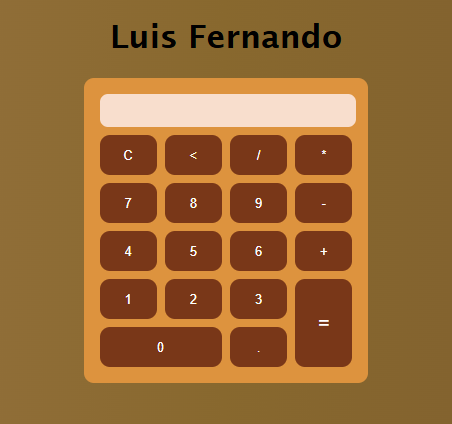

Projeto de uma calculadora desenvolvida com HTML, CSS e JavaScript, com objetivo de praticar conceitos de desenvolvimento web
lógica e a manipulação de elementos da página.

Operações de adição, subtração, multiplicação e divisão, e funções para limpar os valores, apagar o ultimo caracter e exibir 
os valores e resultados na tela.

Para executar basta clonar este repositório, ir na pasta do projeto e abrir o arquivo index.html.
## preview

